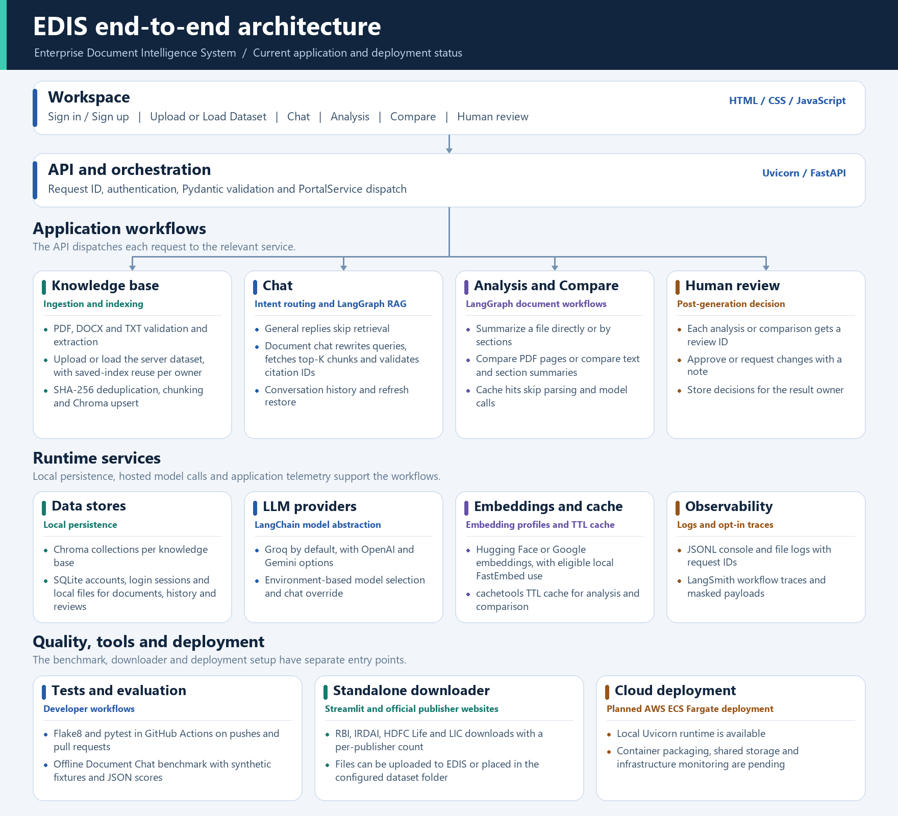
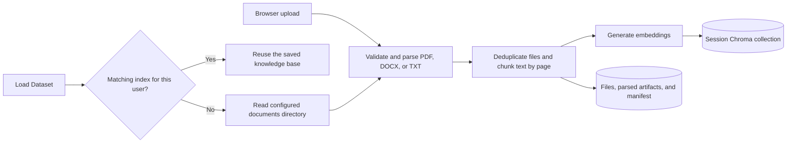
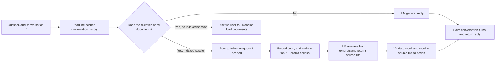

# EDIS end-to-end architecture

Enterprise Document Intelligence System (EDIS) lets users build a document knowledge base, ask questions with page citations, generate summaries, and compare document versions. The workspace also supports general chat and human review of generated analysis and comparison results.

## System components

| Layer | Services and responsibilities |
| --- | --- |
| Browser | FastAPI serves the HTML, CSS, and JavaScript workspace. Users can sign up, sign in, toggle password visibility, upload files, load the server dataset, chat, analyze, compare, and review results. |
| API and orchestration | Uvicorn hosts FastAPI. Route handlers authenticate requests, validate inputs with Pydantic, and call `PortalService`. Async upload, dataset, analysis, and compare endpoints use a thread pool for blocking workflow work. |
| Authentication and authorization | Local accounts use SQLite, salted scrypt password hashes, and HTTP-only login cookies. A local development mode and JWT bearer mode are also available. `APP_ENV=production` requires JWT mode. Session and review access are checked against the authenticated owner. |
| Document ingestion and retrieval | PyMuPDF, `docx2txt`, and the TXT reader extract text. The indexer chunks text, deduplicates files by SHA-256 within the knowledge base, and writes document vectors and page metadata to a per-session Chroma collection. |
| Model providers | `ModelProvider` builds LangChain chat models from environment settings. Groq is the default and has configured rate-limit fallbacks. OpenAI and Gemini are alternatives. `CHAT_LLM_PROVIDER` can override the shared provider for chat. Embedding configuration is independent of chat model configuration. |
| AI workflows | LangGraph orchestrates document chat, segmented analysis, and document comparison. General chat goes directly through the chat service and the selected LLM. `PromptManager` holds the prompts. |
| Cache and review | `cachetools` keeps successful analysis and comparison results in process memory. Each returned result has its own review record, with an approval or a request for changes and a note. |
| Observability and evaluation | `structlog` writes JSONL logs to the console and files. Optional LangSmith traces share the request ID. The offline Document Chat benchmark produces a local JSON report. GitHub Actions runs Flake8 and pytest. |
| Standalone downloader | A separate Streamlit app uses the publisher download module to fetch public documents. The main workspace indexes files supplied through upload or its configured server dataset directory. |

## 1. Account and workspace entry

1. The browser opens `/workspace`. With local accounts enabled, FastAPI redirects unsigned users to the login page. Signup and login issue a session cookie. Logout invalidates the login session.
2. The browser checks the authenticated account and looks for the active knowledge-base session in the current tab. If needed, it checks whether the user already has a saved index for the configured dataset.
3. FastAPI resolves the current user before accessing their session or history. A new account gets its own knowledge base when it uploads files or loads the dataset.

## 2. Document ingestion and knowledge base

- **Upload Documents** reads files selected in the browser. **Load Dataset** reads the configured `DATASET_DIR`, which defaults to `documents/`. The dataset fingerprint supports saved-index reuse for the same owner when the dataset and compatible index still match.
- The parser applies filename, extension, size, and extraction limits. PDF extraction preserves page numbers. Image-only scans require a separate OCR step before ingestion.
- The indexer uses overlapping chunks and deterministic chunk IDs. Chroma stores text, source filename, page number, and file hash with the vector. The manifest tracks indexed documents and the embedding profile used for that session.
- Embeddings use Hugging Face Inference by default, with Google embeddings configurable. If hosted Hugging Face credits are unavailable while building an empty index, the app can use the local FastEmbed model. Query embeddings use the profile recorded in the index.

## 3. General chat, document chat, and memory

- Simple greetings still receive an LLM reply. The router validates other intents with Pydantic and retries an invalid route once. A second invalid route prompts the user to rephrase. General responses bypass retrieval and carry an empty source list.
- Document chat can rewrite follow-ups using the thread history and retry the original question when the rewritten search yields no hits. Retrieval is scoped to the owned index. Document excerpts reach the model as untrusted data in a separate message.
- Backend citation checks resolve only IDs from excerpts provided in the current request. Missing evidence or invalid citations produce a no-evidence reply without source cards.
- The server saves up to 40 recent messages in each document session history and in each user's general chat history. The browser retains the active conversation ID per scope in `sessionStorage` and restores messages and citation cards after refresh in the same tab. **New Chat** starts a fresh thread while keeping the document index active. The app manages history through `SessionStorage`.

## 4. Analysis, comparison, cache, and human review

| Flow | Execution |
| --- | --- |
| Analysis & Summary | Accepts one file. Smaller inputs go directly to the model. Long inputs use LangGraph to summarize sections and combine them. Pydantic validates the resulting title, summary, keywords, language, and page count. |
| Compare | Accepts an ordered reference and updated document. For PDFs, LangGraph aligns pages and reports added, removed, changed, and unchanged content. Unchanged text skips the model call. Other formats use whole-document comparison or section summaries for long text. |
| Result caching | After basic upload validation, the API checks a user-scoped, versioned key derived from file hashes, model settings, and parsing limits. Analysis includes the filename. Compare includes file types and document order. A cache hit skips parsing and model execution. The process holds up to 100 successful results for up to one hour and coordinates concurrent requests for the same key. |
| Human review | A successful result receives a fresh `X-Review-ID`, including on a cache hit. The owner can approve it or request changes with a required note. The server stores the decision and timestamps. Review happens after generation. |

Analysis and Compare accept uploaded files directly and run independently of a document chat knowledge base.

## 5. API and storage map

| Capability | API |
| --- | --- |
| Health | `GET /api/health` |
| Accounts | `POST /api/auth/signup`, `POST /api/auth/login`, `POST /api/auth/logout`, `GET /api/auth/session` |
| Knowledge bases | `POST /api/sessions`, `GET /api/sessions/{session_id}`, `DELETE /api/sessions/{session_id}` |
| Ingestion | `POST /api/sessions/{session_id}/documents`, `GET /api/dataset/session`, `POST /api/sessions/{session_id}/dataset` |
| Chat and history | `POST /api/chat`, `GET /api/chat/history/{conversation_id}`, `POST /api/sessions/{session_id}/chat`. Session detail includes document chat history. |
| Analysis and compare | `POST /api/analyze`, `POST /api/compare` |
| Human review | `GET /api/reviews/{review_id}`, `PUT /api/reviews/{review_id}` |

| Store | Contents |
| --- | --- |
| `DATASET_DIR` | Source documents loaded explicitly from the workspace. Defaults to `documents/`. |
| `STORAGE_DIR/sessions/` | Uploaded and indexed originals, session manifests, and document chat history. |
| `STORAGE_DIR/chroma/` | Persistent local vector indexes and chunk metadata. |
| `STORAGE_DIR/accounts.sqlite3` | Local accounts and login sessions when SQLite auth is enabled. |
| `STORAGE_DIR/general_chat/` and `STORAGE_DIR/result_reviews/` | Per-owner general chat history and owner-scoped review records. |
| `OUTPUT_DIR` | Parsed ingestion artifacts. Defaults to `output/`. `STORAGE_DIR` defaults to `OUTPUT_DIR/storage`. |
| `logs/` | Structured application logs. The same JSONL events are available in the console. |
| Process memory | Analysis and comparison result cache, plus initialized model clients. |

## 6. Operations, evaluation, and deployment

- **Observability.** FastAPI adds `X-Request-ID` to responses. Structured logs include operation progress, duration, cache outcomes, and exception diagnostics. LangSmith traces, when enabled, include nested workflow runs and the request ID. Prompt and output payloads are hidden, and exported error text is redacted.
- **Offline evaluation.** `python -m app.ai_module.evals` builds a temporary synthetic handbook index and runs seven Document Chat cases for facts, citations, missing evidence, and general-chat routing. It uses the configured providers, disables LangSmith tracing for the benchmark, and emits results as local JSON.
- **CI.** `.github/workflows/ci.yml` runs Flake8 and pytest on pushes and pull requests. The regression tests use mocked model calls and require no production API keys.
- **Deployment status.** The workspace runs locally with Uvicorn. AWS ECS Fargate deployment is planned. `Dockerfile` and `.dockerignore` are empty, and GitHub Actions currently runs lint and tests. Session history, reviews, accounts, and Chroma are local stores. A multi-task deployment would need explicit durable storage and a shared-state design. The README lists distributed caching, infra monitoring, and LLM gateway options for future integration.

## 7. Standalone document downloader

The Streamlit downloader in `data_downloading_script/` discovers documents from the official RBI, IRDAI, HDFC Life, and LIC pages. Each publisher has its own download action, and users can also download from all publishers with a selected count per publisher. Files are saved under `data_downloading_script/downloads/`, and the UI reports new and already-saved files. To use a downloaded file in EDIS, upload it or place it in the configured dataset directory and use **Load Dataset**.

## Source entry points

- [Workspace UI](../app/ui/workspace.html) and [browser behavior](../app/ui/app.js)
- [FastAPI application](../app/main.py), [document API routes](../app/api/routes.py), and [auth routes](../app/api/auth_routes.py)
- [PortalService](../app/services/document_workflows.py), [ingestion](../app/ai_module/document_ingestion.py), and [Chroma indexing](../app/ai_module/retrieval.py)
- [Document Chat graph](../app/ai_module/document_chat_graph.py), [analysis](../app/ai_module/document_analysis.py), and [comparison](../app/ai_module/document_compare.py)
- [Result cache](../app/services/document_result_cache.py), [session storage](../app/services/session_storage.py), and [result review store](../app/services/result_reviews.py)
- [LangSmith tracing](../app/utils/langsmith_tracing.py), [offline benchmark](../app/ai_module/evals.py), and [CI workflow](../.github/workflows/ci.yml)
- [Standalone downloader](../data_downloading_script/streamlit_app.py) and [configuration guide](../README.md)
